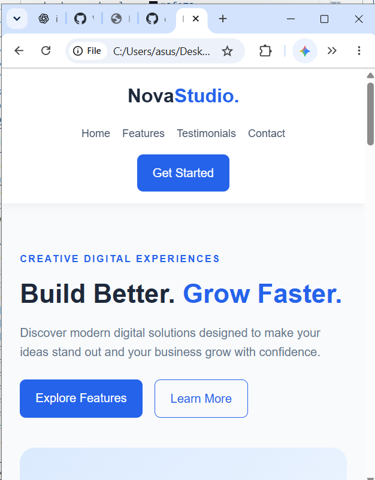
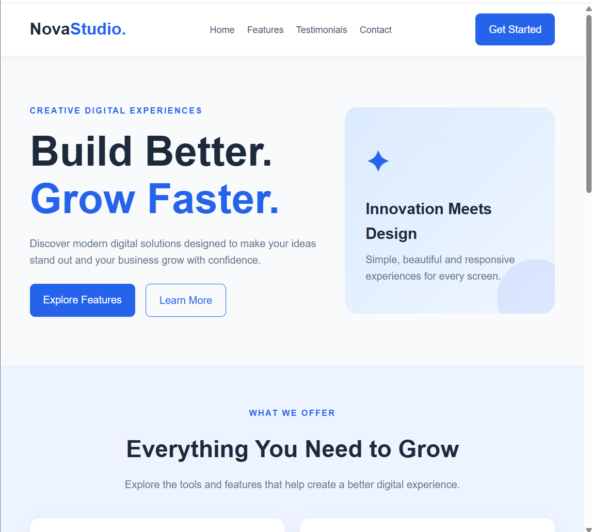
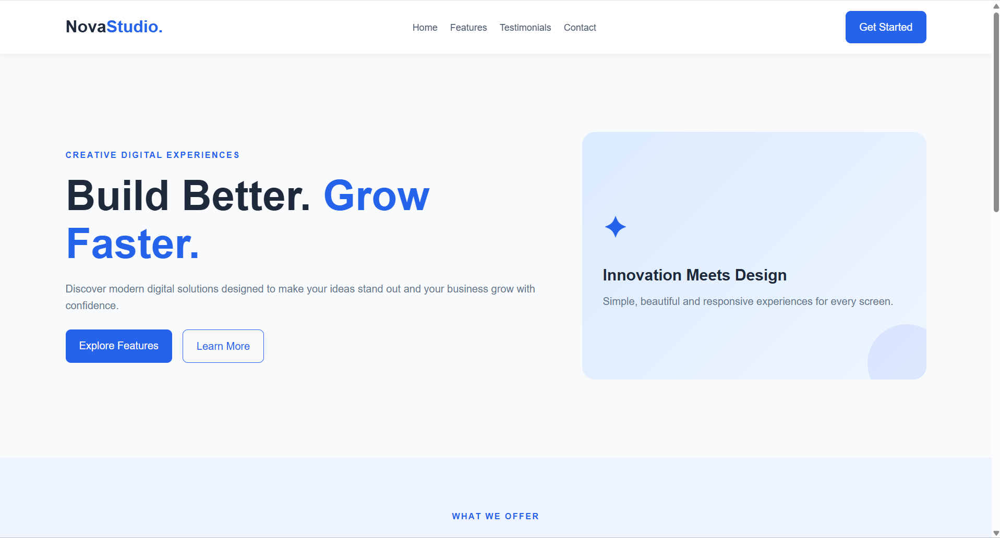

# Week 2 - Day 2: Responsive Design

## Project Overview
A fully responsive, mobile-first landing page built using HTML5 and CSS3.

## Technologies Used
- HTML5
- CSS3
- Flexbox
- CSS Grid
- Media Queries

## Sections
1. Hero Section
2. Features Section
3. Testimonials Section
4. Footer

## Responsive Breakpoints
- 320px - Mobile
- 768px - Tablet
- 1024px - Laptop
- 1440px - Desktop

## Chrome DevTools Screenshots

### Mobile View

### Tablet View

### Desktop View

## Key Features
- Mobile-first responsive layout
- Flexbox navigation
- CSS Grid feature cards
- Responsive testimonials
- Smooth scrolling
- Sticky navigation
- Hover transitions

## Learning Outcome
Learned to build responsive layouts using CSS Grid,
Flexbox and media queries.
